## 📊 HAXELYN // GitHub Statistics

### 🌌 Profile Overview

<picture>
  <source media="(prefers-color-scheme: dark)"
    srcset="./assets/overview.dark.svg">
  
</picture>

### 💻 Programming Languages

<picture>
  <source media="(prefers-color-scheme: dark)"
    srcset="./assets/languages.dark.svg">
  
</picture>

### 🔥 Contribution Activity

<picture>
  <source media="(prefers-color-scheme: dark)"
    srcset="./assets/contributions.dark.svg">
  
</picture>

### 📈 Contribution Momentum

<picture>
  <source media="(prefers-color-scheme: dark)"
    srcset="./assets/momentum.dark.svg">
  
</picture>

