<!-- ================================= -->
<!--       HAXELYN PROFILE v3.0        -->
<!--        AZURE CYBER ANIME          -->
<!-- ================================= -->

<div align="center">


<br/>


<br/>


</div>

---

<div align="center">

## 🌌 ABOUT ME

*「Creating worlds, one line of code at a time.」*

</div>

Hi! I'm **Haxelyn**, also known as **Gbtz-EDITZ**.

I'm a creative developer who enjoys building games, writing code, creating digital art, and listening to music.

```python
class Haxelyn:
    def __init__(self):
        self.name = "Haxelyn"
        self.username = "Gbtz-EDITZ"

        self.roles = [
            "Game Developer",
            "Programmer",
            "Digital Artist",
            "Music Enthusiast"
        ]

        self.languages = [
            "Python",
            "Lua",
            "JavaScript"
        ]

        self.status = "Always creating something new"

    def introduce(self):
        return "Welcome to my digital world!"
```

---

## ⚡ TECHNOLOGY & TOOLS

<div align="center">


<br/><br/>


</div>

---

## 🚀 CURRENT PROJECTS

<table>
<tr>
<td width="50%">
<h3>🎃 THE HALLOWEEN</h3>
A multiplayer horror game built in Roblox.


</td>
<td width="50%">
<h3>🤖 DISCORD BOT</h3>
Music automation and server management.


</td>
</tr>
<tr>
<td width="50%">
<h3>🐍 PYTHON PROJECTS</h3>
Personal coding experiments and automation.


</td>
<td width="50%">
<h3>🎨 DIGITAL ART</h3>
Character concepts and creative experiments.


</td>
</tr>
</table>

---

## 📊 GITHUB STATISTICS

<div align="center">



<br/><br/>




<br/><br/>



</div>

---

## 🐍 CONTRIBUTION SNAKE

<div align="center">


</div>

---

## 🎧 MUSIC & CREATIVE MIND

<div align="center">


**♪ Code with passion. Create with imagination.**

*Every project begins with an idea.*


</div>
