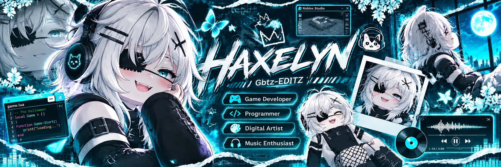

<!--
  HAXELYN // CYBER NEBULA
  VERSION 4.0
-->

 

 

  

 

# ◈ CHARACTER PROFILE ◈

`HAXELYN`  `ID: GBTZ-EDITZ`  `CLASS: CREATOR`

<table>
<tr>
<td width="65%">

### 🌌 About Me

Hello! I'm **Haxelyn**.

A creative person who loves building things, exploring technology and creating new experiences.

- 🎮 Game Developer
- 💻 Programmer
- 🎨 Digital Artist
- 🎧 Music Enthusiast
- 🌐 Exploring the digital universe

**Current Status:** Creating something new...

</td>
<td width="35%" align="center">

**HAXELYN**

`ONLINE`

</td>
</tr>
</table>

 

## ⚙️ TECHNOLOGY SYSTEM

*Tools I use to create and build.*

 

  

 

## 🚀 PROJECT DATABASE

<table>
<tr>
<td width="50%" align="center">

### 🎃 THE HALLOWEEN

Multiplayer horror game.

</td>
<td width="50%" align="center">

### 🤖 DISCORD BOT

Music and automation experiments.

</td>
</tr>
<tr>
<td width="50%" align="center">

### 🐍 PYTHON LAB

Coding experiments and utilities.

</td>
<td width="50%" align="center">

### 🎨 DIGITAL ART

Character concepts and illustrations.

</td>
</tr>
</table>

 

## 📊 SYSTEM STATISTICS

 

  

  

 

## 🐍 CONTRIBUTION MATRIX

 

## 🎧 CURRENT FREQUENCY

`CREATING` • `CODING` • `IMAGINING`

*"The world is just another canvas."*

 

**HAXELYN // END OF TRANSMISSION**

`THANK YOU FOR VISITING MY WORLD`

